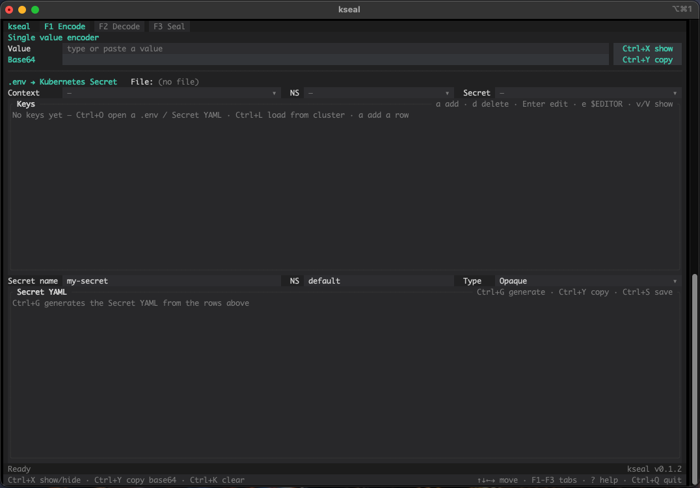

# kseal

Kubernetes Secrets in your terminal: base64 encode/decode, `.env` → Secret YAML,
native SealedSecret sealing and validation, semantic diffs, security checks and
a GitOps export wizard for Argo CD and Flux. You don't need the `kubeseal`
binary. kseal ships as one static binary with a TUI and scriptable subcommands.

> **Read-only against the cluster.** kseal lists contexts, namespaces and
> secrets, reads a Secret, fetches the sealed-secrets certificate and asks the
> controller to verify a SealedSecret. It never creates, patches, replaces or
> deletes anything; applying the output is up to you (or your GitOps). The
> mutating `kube::Api` methods are banned in `clippy.toml`, so CI fails if one
> sneaks in. GitOps exports are local files: kseal never commits, pushes,
> applies or syncs anything.



## Install

**Homebrew** (macOS, Linux)

```bash
brew tap charalamposlamprou/kseal https://github.com/charalamposlamprou/kseal
brew trust charalamposlamprou/kseal     # Homebrew asks once for third-party taps
brew install kseal
```

**Shell installer** (macOS, Linux)

```bash
curl --proto '=https' --tlsv1.2 -LsSf https://github.com/charalamposlamprou/kseal/releases/latest/download/kseal-installer.sh | sh
```

**PowerShell installer** (Windows; an `.msi` is also attached to each release)

```powershell
powershell -ExecutionPolicy Bypass -c "irm https://github.com/charalamposlamprou/kseal/releases/latest/download/kseal-installer.ps1 | iex"
```

**From source** (Rust 1.85+)

```bash
cargo install --locked --git https://github.com/charalamposlamprou/kseal
```

Prebuilt binaries cover macOS (Apple Silicon and Intel), Linux x86_64 and
arm64 (static musl, plus x86_64 glibc) and Windows x86_64.

## Usage

### TUI

Run `kseal` with no arguments. It reads your kubeconfig (`$KUBECONFIG` or
`~/.kube/config`) and picks the current context.

| Tab | What it does |
|---|---|
| **Encode** | Live single-value base64 encoder. `.env` → Secret: open a `.env` or Secret YAML, or load a Secret from the cluster, then edit the key/value table, set name / namespace / type and generate the YAML. The type is guessed from the keys (`tls.crt` + `tls.key` → `kubernetes.io/tls`, …) until you pick one. |
| **Decode** | Live single-value decoder. Open a Secret YAML (multi-document files and `kind: List` work) and get a masked table of its decoded values. |
| **Seal** | Seal the Encode tab's YAML for a context: strict, namespace-wide or cluster-wide scope. The controller is auto-detected per context (editable), or you can seal offline with a certificate. **Validate** asks the controller whether it can decrypt the result. |
| **GitOps** | Export wizard: pick the source (the Encode tab's Secret, or a Secret YAML file), the target namespace and scope, and the workflow (Generic, Argo CD, Flux). Ctrl+E seals and validates it, Ctrl+T asks the controller, Ctrl+D diffs it against the file already there, and Ctrl+S asks where to export it (pre-filled, Tab completes; Ctrl+O on the Output field chooses the destination without exporting). |

Values stay masked until you reveal them. Labels, annotations and `immutable`
survive a load → generate round-trip, and binary values pass through
untouched. Malformed metadata that had to be dropped gets a persistent warning
on every tab. Saved files are written owner-only (`0600`).

Every save is checked first. kseal refuses to write through a symlink, and it
asks before writing when a check finds something High or worse: a plain Secret
inside a Git working tree, a world-writable directory, a plain Secret next to
the SealedSecret you're exporting, or a `kustomization.yaml` whose `namespace:`
or `namePrefix` would break the seal. An existing file is never replaced
silently: you see a diff of what changes, then `y` overwrites it.

#### Diff

Ctrl+D compares the Encode tab's YAML, the Seal tab's output or the GitOps
preview with a local Secret or SealedSecret manifest. Multi-document files and
`kind: List` work. The comparison is semantic: keys added (`+`), removed (`-`)
or modified (`~`), plus type, scope, labels and annotations. Server-managed
metadata (`uid`, `resourceVersion`, …) and controller tracking stamps are
ignored, so a live Secret compares cleanly with its manifest.

Leave the path empty to compare with the **live Secret in the cluster**
instead: the one the output would replace, read-only. The Encode tab uses its
own context; the Seal and GitOps tabs use the context they seal for. That
answers "what will this change in the cluster?" with real values.

When the output is a SealedSecret kseal just sealed, it still holds the plain
Secret it sealed it from. So the new side's values are known: shown masked, and
against a plain old side (such as the live Secret) really compared. The old
side of a sealed-vs-sealed diff stays `‹encrypted›`, since only the controller
can decrypt it.

Values are masked, with a fixed-width mask that doesn't leak their length.
Ctrl+X reveals them; it's explicit and per diff. Encrypted values can't be
compared without the controller's private key, so a ciphertext that differs is
marked `?` ("may or may not have changed") and never reported as modified.

#### GitOps export

| Workflow | What changes |
|---|---|
| Generic | Canonical output (sorted keys). Tracking metadata copied from a live Secret is kept, with a warning |
| Argo CD | Also drops `argocd.argoproj.io/tracking-id` (and Flux's labels) from the template, so a Secret loaded from a cluster doesn't carry its old owner into Git |
| Flux | The same, plus a reminder that a Kustomization's `spec.targetNamespace` must match the sealed namespace |

The output is deterministic apart from the ciphertext, which sealed-secrets
randomizes on every seal by design. kubectl's last-applied snapshot is always
dropped. Labels and annotations are preserved.

#### Validation

The findings pane (and `kseal lint`) rates each finding Critical, High,
Medium, Low or Info, and names the resource or key, the problem and the fix. It
never shows a value. The checks:

- **Secrets:** a malformed manifest, invalid names, namespaces and keys, data
  that isn't base64, keys missing for a built-in type (`kubernetes.io/tls`
  without `tls.key`, …), invalid `.dockerconfigjson`, an expired `tls.crt`, the
  1 MiB size limit, a key in both `data` and `stringData`, a single-line value
  ending in a newline, and a last-applied snapshot. Cluster-owned Secrets that
  don't belong in Git are flagged too: the sealed-secrets controller's own
  sealing key (Critical, blocks export), Helm release records and
  ServiceAccount tokens.
- **SealedSecrets:** apiVersion, identity, scope annotations (conflicting,
  missing namespace, cluster-wide exposure), a template name or namespace that
  differs from the SealedSecret's, unencrypted `spec.template.data`, a
  last-applied snapshot, and the ciphertext layout (including a key size that
  can't match the certificate).
- **Certificates:** not PEM or X.509, not RSA, expired, not yet valid,
  expiring within 30 days, and RSA keys under 2048 bits.
- **Files:** a plain Secret in the same file as SealedSecrets, duplicate
  resources, and the target checks listed above.

SealedSecret checks are **structural**. Only the controller can say whether a
manifest decrypts (Ctrl+T, `kseal validate`), and kseal never claims it does
without asking.

#### Keys

| Key | Action |
|---|---|
| `↑` `↓` `←` `→` | Move between fields, following the layout. Inside a table, a YAML pane or a text box they move or scroll there first, and continue to the neighbouring field at the edge |
| `Tab` / `Shift-Tab` | Next / previous field |
| `F1` … `F4` / `Ctrl+N` `Ctrl+P` | Switch tabs |
| `Ctrl+G` | Generate Secret YAML |
| `Ctrl+O` | Open a file: `.env` or Secret YAML, detected automatically (Seal tab: certificate) |
| `Ctrl+L` | Load the selected Secret from the cluster |
| `Ctrl+E` / `Ctrl+T` | Seal / validate (GitOps tab: preview and check / ask the controller) |
| `Ctrl+D` | Diff the output against a local Secret / SealedSecret file |
| `Ctrl+Y` | Copy whatever is focused |
| `Ctrl+S` | Save the YAML / SealedSecret (GitOps tab: export) |
| `Ctrl+K` | Clear the focused thing |
| `Ctrl+R` | Reload contexts (also clears the controller cache) |
| `Ctrl+X` | Show / hide masked values |
| `?` | Help |
| `Ctrl+C` / `Ctrl+Q` | Quit |

In a key table: `a` add, `d` delete, `Enter` edit, `e` edit the value in
`$EDITOR` (for multi-line values such as PEM keys or JSON), `v` / `V` show one
or all. Pickers open with `Enter` and filter as you type. In the diff viewer:
`n` / `N` next / previous change, `Ctrl+X` reveal values, `y` overwrite (when
it asks), `Esc` close.

Over SSH, copying uses OSC 52, so the text lands in your *local* clipboard
(your terminal must allow OSC 52; in tmux, enable `set-clipboard`).

### Command line

Every feature also works in scripts:

```bash
kseal encode hunter2                          # aHVudGVyMg==
echo -n aHVudGVyMg== | kseal decode           # hunter2
kseal gen -f prod.env --name db -n prod > secret.yaml
kseal show -f secret.yaml [--reveal]          # decoded keys, masked by default
kseal get db -n prod --format env             # read a Secret as .env (or --format yaml)
kseal seal -f secret.yaml --scope strict -o sealed.yaml
kseal validate -f sealed.yaml                 # exit 1 if the controller can't decrypt it
kseal cert > cert.pem                         # then, offline: kseal seal --cert cert.pem

kseal diff secret.yaml sealed.yaml            # semantic diff, values masked (--reveal, --exit-code)
kseal lint -f sealed.yaml --cert cert.pem     # findings; exit 1 at --fail-on (default high)
kseal export -f secret.yaml --workflow argocd --scope strict -o apps/db/sealed-db.yaml
kseal export -f secret.yaml --workflow flux -n staging --cert cert.pem -o clusters/staging/sealed-db.yaml
```

`export` seals the Secret and prints its findings. It writes nothing if a
finding reaches `--fail-on` (default `critical`), and it won't replace an
existing file unless you pass `--force`; then it prints what changes first.

`--context` (or `KSEAL_CONTEXT`) selects a kubeconfig context. The controller
is auto-detected, or set it with `--controller-name` / `--controller-namespace`.
Run `kseal <command> --help` for every flag.

## Development

```bash
cargo fmt --check
cargo clippy --all-targets -- -D warnings
cargo test                 # the sealing interop test also runs if `go` is on PATH
scripts/e2e-kind.sh        # opt-in: throwaway KinD cluster + real sealed-secrets controller
```

Pure logic lives in `src/core.rs`, `src/diff.rs` (semantic diff),
`src/validate.rs` (security rules) and `src/gitops.rs` (export), all
unit-tested. The certificate fixtures in `tests/fixtures/` are dummy, cert-only
PEMs with no private keys. The TUI in `src/tui/` is
Elm-style: `app.rs` holds the state and update logic and never does I/O,
`mod.rs` runs its effects on tokio, and `ui.rs` renders.

## Releasing

Every PR merged into `main` cuts a release; the default bump is patch. Label
the PR `release:minor` or `release:major` to bump higher, or `release:skip`
to merge without releasing. `tag-on-merge.yml` bumps `Cargo.toml` to the new
version, commits it to `main`, pushes the `vX.Y.Z` tag and starts
`release.yml` ([dist](https://github.com/axodotdev/cargo-dist)). That builds
every target and publishes the GitHub release and installers, then
`publish-homebrew.yml` commits the updated formula to `Formula/` in this repo.

No secrets are needed: everything runs on the built-in `GITHUB_TOKEN`. If
`main` is protected, allow GitHub Actions to push to it (the version bump and
the formula are committed there).

To release by hand, push a version tag that matches `Cargo.toml`, then run
`gh workflow run release.yml --ref vX.Y.Z -f tag=vX.Y.Z`.

## License

MIT
