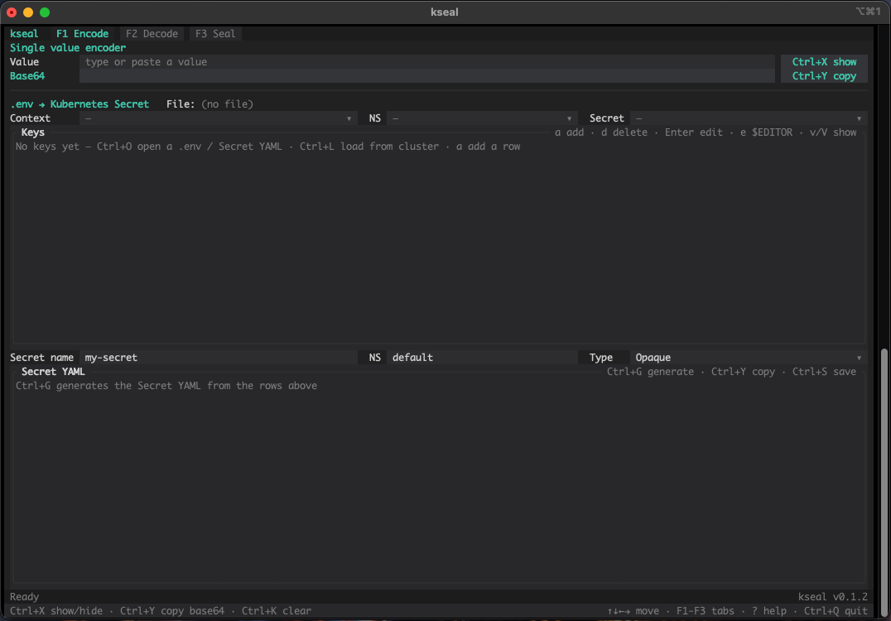

# kseal

Kubernetes Secrets in your terminal: base64 encode/decode, `.env` → Secret YAML,
and native SealedSecret sealing and validation. You don't need the `kubeseal`
binary. kseal ships as one static binary with a TUI and scriptable subcommands.

> **Read-only against the cluster.** kseal lists contexts, namespaces and
> secrets, reads a Secret, fetches the sealed-secrets certificate and asks the
> controller to verify a SealedSecret. It never creates, patches, replaces or
> deletes anything; applying the output is up to you (or your GitOps). The
> mutating `kube::Api` methods are banned in `clippy.toml`, so CI fails if one
> sneaks in.



## Install

**Homebrew** (macOS, Linux)

```bash
brew tap charalamposlamprou/kseal https://github.com/charalamposlamprou/kseal
brew trust charalamposlamprou/kseal     # Homebrew asks once for third-party taps
brew install kseal
```

**Shell installer** (macOS, Linux)

```bash
curl --proto '=https' --tlsv1.2 -LsSf https://github.com/charalamposlamprou/kseal/releases/latest/download/kseal-installer.sh | sh
```

**PowerShell installer** (Windows; an `.msi` is also attached to each release)

```powershell
powershell -ExecutionPolicy Bypass -c "irm https://github.com/charalamposlamprou/kseal/releases/latest/download/kseal-installer.ps1 | iex"
```

**From source** (Rust 1.85+)

```bash
cargo install --locked --git https://github.com/charalamposlamprou/kseal
```

Prebuilt binaries cover macOS (Apple Silicon and Intel), Linux x86_64 and
arm64 (static musl, plus x86_64 glibc) and Windows x86_64.

## Usage

### TUI

Run `kseal` with no arguments. It reads your kubeconfig (`$KUBECONFIG` or
`~/.kube/config`) and picks the current context.

| Tab | What it does |
|---|---|
| **Encode** | Live single-value base64 encoder. `.env` → Secret: open a `.env` or Secret YAML, or load a Secret from the cluster, then edit the key/value table, set name / namespace / type and generate the YAML. The type is guessed from the keys (`tls.crt` + `tls.key` → `kubernetes.io/tls`, …) until you pick one. |
| **Decode** | Live single-value decoder. Open a Secret YAML (multi-document files and `kind: List` work) and get a masked table of its decoded values. |
| **Seal** | Seal the Encode tab's YAML for a context: strict, namespace-wide or cluster-wide scope. The controller is auto-detected per context (editable), or you can seal offline with a certificate. **Validate** asks the controller whether it can decrypt the result. |

Values stay masked until you reveal them. Labels, annotations and `immutable`
survive a load → generate round-trip, and binary values pass through
untouched. Malformed metadata that had to be dropped gets a persistent warning
on every tab. Saved files are written owner-only (`0600`).

#### Keys

| Key | Action |
|---|---|
| `↑` `↓` `←` `→` | Move between fields, following the layout. Inside a table, a YAML pane or a text box they move or scroll there first, and continue to the neighbouring field at the edge |
| `Tab` / `Shift-Tab` | Next / previous field |
| `F1` `F2` `F3` / `Ctrl+N` `Ctrl+P` | Switch tabs |
| `Ctrl+G` | Generate Secret YAML |
| `Ctrl+O` | Open a file: `.env` or Secret YAML, detected automatically (Seal tab: certificate) |
| `Ctrl+L` | Load the selected Secret from the cluster |
| `Ctrl+E` / `Ctrl+T` | Seal / validate |
| `Ctrl+D` | Seal tab: diff the output with a file, or (empty path) the live Secret |
| `Ctrl+Y` | Copy whatever is focused |
| `Ctrl+S` | Save the YAML / SealedSecret |
| `Ctrl+K` | Clear the focused thing |
| `Ctrl+R` | Reload contexts (also clears the controller cache) |
| `Ctrl+X` | Show / hide masked values |
| `?` | Help |
| `Ctrl+C` / `Ctrl+Q` | Quit |

In a key table: `a` add, `d` delete, `Enter` edit, `e` edit the value in
`$EDITOR` (for multi-line values such as PEM keys or JSON), `v` / `V` show one
or all. Pickers open with `Enter` and filter as you type. In the diff viewer:
`n` / `N` next / previous change, `Ctrl+X` reveal values, `Esc` close.

#### Saving (Seal tab)

`Ctrl+S` first looks for where this SealedSecret already lives, so a re-seal
updates the right file. It searches the repository (`KSEAL_REPO` if set, else
the Git repo kseal was started in) for a SealedSecret with the same namespace
and name. Overlays count too, when the folder's `kustomization.yaml` sets the
namespace. Then it asks the controller you sealed for whether it can decrypt
each match, with the same read-only check as Ctrl+T, because the same Secret
often exists once per environment.

- **Matches found:** a "Save to" list, each labelled `this cluster` or
  `another cluster`, plus a new file. This cluster's match is preselected.
  Picking another cluster's file warns you first. The choice opens the usual
  prompt, so you can still edit it.
- **No match:** the prompt suggests a full path, in this order: the folder you
  saved to last this session, `<repo>/sealed-<name>.yaml`, or the current
  folder.

```bash
export KSEAL_REPO=~/src/gitops-repo   # optional, e.g. in ~/.zshrc
```

#### Diff (Seal tab)

`Ctrl+D` compares the sealed output with a local Secret or SealedSecret
manifest. Leave the path empty to compare with the **live Secret** it would
replace, read-only, in the context it was sealed for. The comparison is
semantic, and multi-document files and `kind: List` work: keys added (`+`),
removed (`-`) or modified (`~`), plus type, scope, labels and annotations.
Server-managed metadata and controller tracking stamps are ignored.

kseal still holds the YAML it sealed, so the new values are known. Against a
plain Secret, including the live one, they're really compared. Against
another SealedSecret, the old side stays `‹encrypted›`, since only the
controller can decrypt it. Values are masked (the mask has a fixed width, so it
doesn't leak length) until `Ctrl+X`.

Over SSH, copying uses OSC 52, so the text lands in your *local* clipboard
(your terminal must allow OSC 52; in tmux, enable `set-clipboard`).

### Command line

Every feature also works in scripts:

```bash
kseal encode hunter2                          # aHVudGVyMg==
echo -n aHVudGVyMg== | kseal decode           # hunter2
kseal gen -f prod.env --name db -n prod > secret.yaml
kseal show -f secret.yaml [--reveal]          # decoded keys, masked by default
kseal get db -n prod --format env             # read a Secret as .env (or --format yaml)
kseal seal -f secret.yaml --scope strict -o sealed.yaml
kseal validate -f sealed.yaml                 # exit 1 if the controller can't decrypt it
kseal cert > cert.pem                         # then, offline: kseal seal --cert cert.pem
```

`--context` (or `KSEAL_CONTEXT`) selects a kubeconfig context. The controller
is auto-detected, or set it with `--controller-name` / `--controller-namespace`.
Run `kseal <command> --help` for every flag.

### From an AI agent

Coding agents (Claude Code, Cursor, Codex, …) can drive kseal with no MCP
server. Anything a command prints lands in the model's context, so split the
work: **the agent handles paths, contexts and git; you edit the values.**

1. **Fetch** (agent): `kseal-fetch CONTEXT NAMESPACE NAME` copies the live
   Secret to `~/.kseal-secrets/<context>/<namespace>/<name>.env`, outside any
   git repo and owner-only. It prints key names only.
2. **Edit** (you): add, change or remove `KEY=value` lines in that file.
3. **Seal** (agent): `kseal-seal CONTEXT NAMESPACE NAME path/in/gitops-repo.yaml --push`
   seals for that context's controller and validates the result. It then
   commits only that file and pushes the current branch. It never applies
   anything: Argo CD or Flux syncs it from git. It prints key names, which
   keys were added, changed or removed compared with the live Secret, and
   the commit.

**A new service** has no live Secret to fetch, so the agent starts one from
the key names instead. Those come from the service's config (its manifest,
`.env.example`, docs) and aren't secret:

```sh
kseal-fetch CONTEXT NAMESPACE NAME --new STRIPE_KEY,WEBHOOK_SECRET
```

This writes the same owner-only `.env` with empty `KEY=` lines. Key names
follow kseal's rules (letters, digits, `_`, `.`, `-`, so `tls.crt` works).
It refuses if the Secret already exists, if the namespace doesn't, or if it
can't tell. You fill in the values, and the agent seals as usual.
`kseal-seal` refuses to seal a template while any value is still empty, so a
half-filled one is never committed. A fetched Secret may keep a value that's
empty on purpose.

**Restricted clusters** (often prod): without read access to Secrets, start
with `--new KEY,... --no-check` and type in every value. Without access to
the controller, seal offline with a certificate someone exports once with
`kseal cert`: `kseal-seal … --cert cert.pem`. That skips validation and the
safety checks below, and the summary says so.

Both scripts are plain Bash (macOS bash 3.2 works) and need kseal, git and
kubectl (only for the namespace and git-vs-cluster checks). Save them on your `PATH`, e.g. in `~/.local/bin`, and `chmod +x` them.

<details>
<summary><code>kseal-fetch</code></summary>

```bash
#!/usr/bin/env bash
# kseal-fetch CONTEXT NAMESPACE NAME [FILE.env] [--force] [--new KEY,KEY...] [--no-check]
# Live Secret → an owner-only .env outside git, for you to edit.
#   --new KEY,...  start a Secret that isn't in the cluster yet (empty KEY= lines);
#                  checks the namespace exists and the Secret doesn't
#   --no-check     with --new: skip that check (no read access to the cluster)
#   --force        replace a .env that has unsealed edits
# Prints key names only.
set -euo pipefail
die() { echo "kseal-fetch: $*" >&2; exit 1; }
usage="usage: kseal-fetch CONTEXT NAMESPACE NAME [FILE.env] [--force] [--new KEY,KEY...] [--no-check]"
force=0 check=1 isnew=0 new="" args=()
while [ $# -gt 0 ]; do
  case "$1" in
    --force) force=1 ;;
    --no-check) check=0 ;;
    --new) [ $# -ge 2 ] || die "--new needs KEY,KEY..."; isnew=1; new="$2"; shift ;;
    --*) die "$usage" ;;
    *) args+=("$1") ;;
  esac
  shift
done
[ ${#args[@]} -ge 3 ] || die "$usage"
ctx="${args[0]}" ns="${args[1]}" name="${args[2]}"
env="${args[3]:-$HOME/.kseal-secrets/${ctx//[\/:]/_}/$ns/$name.env}"
state="$env.state"

keys=()
if [ "$isnew" = 1 ]; then
  case "$new" in ""|,*|*,|*,,*) die "--new has an empty key name: '$new'" ;; esac
  IFS=, read -r -a keys <<<"$new"
  seen=" "
  for k in "${keys[@]}"; do
    case "$k" in *[!A-Za-z0-9_.-]*) die "'$k' isn't a valid key name (letters, digits, _ . -)" ;; esac
    case "$seen" in *" $k "*) die "'$k' is listed twice" ;; esac
    seen="$seen$k "
  done
fi

# An existing .env may hold unsealed edits. It's safe to replace only if
# kseal-seal recorded exactly this content as sealed.
if [ -e "$env" ] && [ "$force" != 1 ] &&
   [ "$(awk '$1 == "sealed" {print $2}' "$state" 2>/dev/null)" != "$(git hash-object "$env")" ]; then
  die "$env has unsealed edits; seal or delete it, or pass --force"
fi

# Hash of the live values as kseal parses them (never printed). kseal-seal
# compares it to the live Secret again, to catch a change made since now.
pairs_hash() {
  kseal show --reveal -f "$1" 2>/dev/null |
    awk 'NF {k = $1; v = $0; sub(/^[^ ]+ +/, "", v); print k "\t" v}' | sort | git hash-object --stdin
}

umask 077
mkdir -p "$(dirname "$env")"
work="$(mktemp -d)"
trap 'rm -rf "$work"' EXIT
stamp="$(date '+%F %R')"
if [ "$isnew" = 1 ]; then
  base=unchecked
  if [ "$check" = 1 ]; then
    # Only a clean "not found" counts, and only in a namespace that exists:
    # a 404 also comes back for a mistyped namespace.
    if kseal get "$name" -n "$ns" --context "$ctx" >/dev/null 2>"$work/err"; then
      die "$ns/$name already exists in $ctx; fetch it without --new"
    fi
    grep -q 'HTTP 404' "$work/err" || die "couldn't check whether $ns/$name exists in $ctx (pass --no-check to skip)"
    command -v kubectl >/dev/null || die "checking the namespace needs kubectl (or pass --no-check)"
    kubectl --context "$ctx" get namespace "$ns" >/dev/null 2>&1 ||
      die "namespace $ns doesn't exist in $ctx, or you can't read it (pass --no-check if you're sure)"
    base=none
  fi
  {
    echo "# new: $ctx $ns/$name at $stamp. Fill in every value. Never commit this file."
    for k in "${keys[@]}"; do echo "$k="; done
  } >"$work/env"
else
  kseal get "$name" -n "$ns" --context "$ctx" --format yaml >"$work/live.yaml" 2>/dev/null ||
    die "couldn't read $ns/$name from $ctx (for a new Secret, use --new)"
  base="$(pairs_hash "$work/live.yaml")"
  {
    echo "# fetched-from: $ctx $ns/$name at $stamp. Never commit this file."
    kseal get "$name" -n "$ns" --context "$ctx" 2>/dev/null
  } >"$work/env" || die "couldn't read $ns/$name from $ctx"
fi
mv "$work/env" "$env"
echo "base $base" >"$state"

echo "kseal-fetch: $ctx $ns/$name → $env"
echo "  keys: $(sed -nE 's/^[[:space:]]*(export[[:space:]]+)?([A-Za-z0-9_.-]+)[[:space:]]*=.*/\2/p' "$env" | tr '\n' ' ')"
[ "$base" = unchecked ] && echo "  note: not checked against $ctx (--no-check)"
exit 0
```

</details>

<details>
<summary><code>kseal-seal</code></summary>

```bash
#!/usr/bin/env bash
# kseal-seal CONTEXT NAMESPACE NAME OUT.yaml [FILE.env] [--push] [--cert CERT.pem] [--force]
# .env → SealedSecret at OUT.yaml in a GitOps repo: sealed for CONTEXT's
# controller, validated, then committed (and pushed with --push).
#   --cert CERT.pem  seal offline (`kseal cert` output): no cluster access,
#                    so no validation and no live or sync checks
#   --force          seal even if the live Secret changed since the fetch, or
#                    git holds a change the cluster hasn't synced yet
# Never applies anything. Prints key names and pass/fail only.
set -euo pipefail
die() { echo "kseal-seal: $*" >&2; exit 1; }
usage="usage: kseal-seal CONTEXT NAMESPACE NAME OUT.yaml [FILE.env] [--push] [--cert CERT.pem] [--force]"
push=0 force=0 cert="" args=()
while [ $# -gt 0 ]; do
  case "$1" in
    --push) push=1 ;;
    --force) force=1 ;;
    --cert) [ $# -ge 2 ] || die "--cert needs a file"; cert="$2"; shift ;;
    --*) die "$usage" ;;
    *) args+=("$1") ;;
  esac
  shift
done
[ ${#args[@]} -ge 4 ] || die "$usage"
ctx="${args[0]}" ns="${args[1]}" name="${args[2]}" out="${args[3]}"
env="${args[4]:-$HOME/.kseal-secrets/${ctx//[\/:]/_}/$ns/$name.env}"
state="$env.state"
[ -z "$cert" ] || [ -f "$cert" ] || die "$cert not found"

[ -f "$env" ] || die "$env not found; run kseal-fetch first"
if git -C "$(dirname "$env")" rev-parse --is-inside-work-tree >/dev/null 2>&1; then
  die "$env is inside a git repo; keep plaintext out of git"
fi
mkdir -p "$(dirname "$out")"
out="$(cd "$(dirname "$out")" && pwd)/$(basename "$out")"
repo="$(git -C "$(dirname "$out")" rev-parse --show-toplevel 2>/dev/null)" || die "$out isn't inside a git repo"
[ -z "$(git -C "$repo" status --porcelain)" ] || die "$repo has uncommitted changes"
# Seal on top of the latest, so nobody's newer change is overwritten.
if git -C "$repo" rev-parse --abbrev-ref '@{u}' >/dev/null 2>&1; then
  git -C "$repo" pull -q --ff-only 2>/dev/null || die "couldn't fast-forward $repo to its upstream"
fi

# State next to the .env (outside git), written by kseal-fetch and kseal-seal:
#   base   <hash of the live values at fetch time | none | unchecked>
#   sealed <hash of the .env> <out> <git blob of out> <hash of the sealed values>
base="$(awk '$1 == "base" {print $2}' "$state" 2>/dev/null)"
read -r _ s_env s_out s_blob s_vals <<<"$(grep '^sealed ' "$state" 2>/dev/null || echo "sealed - - - -")"
env_hash="$(git hash-object "$env")"
if [ "$s_env" = "$env_hash" ] && [ "$s_out" = "$out" ] && [ -f "$out" ]; then
  echo "kseal-seal: $env is unchanged since it was sealed to $out; nothing to seal"
  exit 0
fi

umask 077
work="$(mktemp -d)"
trap 'rm -rf "$work"' EXIT   # EXIT only: an INT/TERM trap would keep running after a kill
kseal gen -f "$env" --name "$name" -n "$ns" -o "$work/plain.yaml" 2>/dev/null ||
  die "couldn't build a Secret from $env"
keys="$(kseal show -f "$work/plain.yaml" | awk 'NF {printf "%s ", $1}')"
# Key/value lines as kseal parses them; compared and hashed, never printed.
pairs() { kseal show --reveal -f "$1" 2>/dev/null | awk 'NF {k = $1; v = $0; sub(/^[^ ]+ +/, "", v); print k "\t" v}'; }
vals_hash="$(pairs "$work/plain.yaml" | sort | git hash-object --stdin)"

if head -1 "$env" | grep -q '^# new:'; then
  # A template from `kseal-fetch --new`: an empty value is unfinished.
  empty="$(kseal show --reveal -f "$work/plain.yaml" 2>/dev/null | awk 'NF == 1 {printf "%s ", $1}')"
  [ -z "$empty" ] || die "these keys have no value yet: $empty"
fi
from="$(sed -nE 's/^# (fetched-from|new): ([^ ]+) .*/\2/p' "$env" | head -1)"

new_base="$base"
changes="not checked (offline)"
checks="skipped (offline cert)"
if [ -z "$cert" ]; then
  # 1. Has the live Secret changed since the fetch? Sealing then would revert
  #    someone's change. Our own last seal, once synced, is expected.
  if kseal get "$name" -n "$ns" --context "$ctx" --format yaml >"$work/live.yaml" 2>/dev/null; then
    live="$(pairs "$work/live.yaml" | sort | git hash-object --stdin)"
    new_base="$live"   # once this seal lands, the live values now are the baseline
    if [ "$force" != 1 ] && [ "$live" != "$base" ] && [ "$live" != "$s_vals" ]; then
      case "$base" in
        ""|unchecked) ;;   # no fetch record (hand-made .env, or --no-check)
        none) die "$ns/$name now exists in $ctx; fetch it instead of using a --new template (or --force)" ;;
        *) die "the live $ns/$name changed since you fetched it. Move $env aside, fetch again and redo your edits (or --force)" ;;
      esac
    fi
    changes="$(awk -F'\t' '
      FNR == NR { old[$1] = $2; next }
      { if (!($1 in old)) a = a " " $1; else if (old[$1] != $2) c = c " " $1; seen[$1] = 1 }
      END { for (k in old) if (!(k in seen)) r = r " " k
            printf "added:%s  changed:%s  removed:%s", a ? a : " -", c ? c : " -", r ? r : " -" }
    ' <(pairs "$work/live.yaml") <(pairs "$work/plain.yaml"))"
    if [ "$changes" = "added: -  changed: -  removed: -" ] && [ -f "$out" ]; then
      echo "kseal-seal: $ns/$name in $ctx already matches $env; nothing to seal"
      exit 0
    fi
  else
    case "$base" in
      ""|none|unchecked) changes="new Secret" ;;
      *) [ "$force" = 1 ] || die "couldn't re-read $ns/$name from $ctx to check it hasn't changed (or --force)"
         changes="live Secret not readable" ;;
    esac
  fi

  # 2. Does git hold a change the cluster hasn't synced yet? Sealing on top of
  #    it would drop it. Our own unsynced seal is fine.
  if [ "$force" != 1 ] && git -C "$repo" ls-files --error-unmatch -- "$out" >/dev/null 2>&1 &&
     [ "$(git hash-object "$out")" != "$s_blob" ]; then
    command -v kubectl >/dev/null || die "checking git against the cluster needs kubectl (or --force)"
    want="$(kubectl --context "$ctx" create --dry-run=client -f "$out" -o jsonpath='{.spec.encryptedData}' 2>/dev/null)" ||
      die "couldn't read $out as a SealedSecret (or --force)"
    have="$(kubectl --context "$ctx" -n "$ns" get sealedsecret "$name" -o jsonpath='{.spec.encryptedData}' 2>"$work/err")" ||
      grep -q NotFound "$work/err" ||
      die "couldn't read the SealedSecret $ns/$name from $ctx to compare with git (or --force)"
    [ "$want" = "$have" ] ||
      die "$out in git differs from the SealedSecret in $ctx: a change hasn't synced yet. Wait for the sync, then fetch again (or --force)"
  fi
  checks="$([ "$force" = 1 ] && echo "skipped (--force)" || echo passed)"

  # Seal and validate in the temp dir, so a failure never leaves a file in the repo.
  kseal seal -f "$work/plain.yaml" --context "$ctx" --scope strict -o "$work/sealed.yaml" 2>/dev/null ||
    die "sealing for $ctx failed"
  kseal validate -f "$work/sealed.yaml" --context "$ctx" 2>"$work/validate.err" ||
    die "$(cat "$work/validate.err")"
  validated="yes"
else
  kseal seal -f "$work/plain.yaml" --cert "$cert" --scope strict -o "$work/sealed.yaml" 2>/dev/null ||
    die "sealing with $cert failed"
  validated="no (offline: check with kseal validate --context $ctx once you can reach it)"
fi
mv "$work/sealed.yaml" "$out"

git -C "$repo" add -- "$out"
git -C "$repo" commit -q -m "seal: $ns/$name for $ctx" -m "keys: $keys"
commit="$(git -C "$repo" rev-parse --short HEAD)"
{ [ -z "$new_base" ] || echo "base $new_base"
  echo "sealed $env_hash $out $(git hash-object "$out") $vals_hash"; } >"$work/state"
mv "$work/state" "$state"
pushed=no
if [ "$push" = 1 ]; then
  git -C "$repo" push -q -u origin HEAD 2>/dev/null || die "committed $commit, but the push failed"
  pushed="$(git -C "$repo" rev-parse --abbrev-ref HEAD)"
fi

echo "kseal-seal: $ctx $ns/$name → $out"
[ -n "$from" ] && [ "$from" != "$ctx" ] && echo "  note:      $env was made for $from"
echo "  keys:      $keys"
echo "  vs live:   $changes"
echo "  checks:    $checks"
echo "  validated: $validated (not applied; GitOps syncs it)"
echo "  commit:    $commit   pushed: $pushed"
```

</details>

How they behave:

- **Your edits are safe.** `kseal-fetch` won't overwrite a `.env` with
  unsealed edits unless you pass `--force`.
- **Nobody's change gets reverted.** `kseal-seal` pulls the GitOps repo
  first (fast-forward only). It refuses if the live Secret changed since you
  fetched it: sealing would undo that change. It also refuses if the file in
  git differs from the SealedSecret in the cluster, meaning someone's change
  hasn't synced yet. Your own unsynced seals don't count. `--force` overrides
  both checks.
- **Re-runs don't add commits.** Every seal produces new ciphertext, so the
  scripts keep a state file next to the `.env` (`<name>.env.state`, hashes
  only) and do nothing if the `.env` hasn't changed since the last seal. That
  holds even before GitOps has synced. It also does nothing when the file
  already matches the live Secret.
- **Refusals:** it won't run when the `.env` is inside a git repo, when the
  GitOps repo has uncommitted changes, or when the controller can't decrypt
  the result. A failed seal or validate never leaves a file in the repo.
- **Cross-cluster is allowed.** A file fetched from one context can be sealed
  for another; the summary adds a `note:` line saying where it came from.
- **Repo layout is yours.** For a new Secret, add the file to your
  kustomization (or whatever your GitOps tool reads) in a separate commit,
  along with the Deployment's `envFrom`/`secretKeyRef` that uses it.
- **`--push` pushes the current branch.** For a PR flow, have the agent
  create a branch first.
- **Clean up when you're done.** The plaintext stays on disk until you
  delete it: `rm ~/.kseal-secrets/<context>/<namespace>/<name>.env{,.state}`.

**Tell the agent.** Add this to `~/.claude/CLAUDE.md` (Claude Code) or
`AGENTS.md`:

```markdown
## Secrets

- Never read, print, search or copy `.env` files or anything under
  `~/.kseal-secrets/`: no Read tool, `cat`, `grep`, `source`, `cp` into a repo.
  Only pass their path to `kseal-fetch` / `kseal-seal`.
- Fetch with `kseal-fetch`, then stop: I edit the values. For a Secret that
  doesn't exist yet, use `kseal-fetch … --new KEY,KEY` with the key names
  the service expects. When I say "seal", run `kseal-seal` with the same
  context, namespace and name. Report its summary. If a key was removed, say
  so.
- If a script refuses, report why and stop. Use `--force`, `--no-check` or
  `--cert` only when I say so.
- Don't run `kseal get`, `show`, `decode`, `encode` or `gen` yourself, and
  never `kubectl apply` a SealedSecret or `kubectl get secret -o yaml`.
- Never write a secret value in a command, commit, PR or reply. If one shows
  up in output by accident, stop and tell me.
```

**Enforce it.** Instructions alone don't stop anything. Add permission rules,
e.g. in Claude Code's `~/.claude/settings.json`:

```json
{
  "permissions": {
    "allow": ["Bash(kseal-fetch:*)", "Bash(kseal-seal:*)"],
    "deny": [
      "Bash(kseal get:*)", "Bash(kseal show:*)", "Bash(kseal decode:*)",
      "Bash(kseal encode:*)", "Bash(kseal gen:*)",
      "Read(**/.env)", "Read(**/*.env)", "Read(**/.env.*)",
      "Read(~/.kseal-secrets/**)"
    ]
  }
}
```

Rules check the command the agent types, not what a script runs inside, so
the scripts still work. The rules are a backstop, not a sandbox: they match
how a command starts, so `/opt/homebrew/bin/kseal get …`, `command kseal …`
or `cat file.env` may get past them. For real isolation, keep plaintext
where the agent's user can't read it.

If you call kseal directly instead:

- **Pass `--context` on every call.** Agents usually run each command in a
  fresh shell, so an exported `KSEAL_CONTEXT` is gone by the next call, and
  kseal falls back to the kubeconfig's current context: the wrong controller.
- **Commands that print secret values:** `get`, `decode`, `encode`, `gen`
  without `-o` (base64 is still the value), and `show`. Masked `show` prints
  one `•` per character up to 12, so it leaks the length of short values;
  `--reveal` prints them. Safe to show: `seal` and `cert` (ciphertext and the
  public certificate) and `validate` (pass/fail).
- **Read `validate`'s stderr, not just its exit code.** It exits 0 with
  `✓ … can decrypt this SealedSecret`. It exits 1 when the controller
  `cannot decrypt this SealedSecret` (reseal), but also when the input has no
  SealedSecret, no controller is found, or the API call fails (unreachable
  cluster, RBAC denied). Resealing won't fix those.
- **Write `gen`'s output to a file with `-o`, not a pipe,** so a failure
  shows its own error instead of a confusing one from `seal`.

## Development

```bash
cargo fmt --check
cargo clippy --all-targets -- -D warnings
cargo test                 # the sealing interop test also runs if `go` is on PATH
scripts/e2e-kind.sh        # opt-in: throwaway KinD cluster + real sealed-secrets controller
```

Pure logic lives in `src/core.rs` (tested). The TUI in `src/tui/` is
Elm-style: `app.rs` holds the state and update logic and never does I/O,
`mod.rs` runs its effects on tokio, and `ui.rs` renders.

## Releasing

Every PR merged into `main` cuts a release; the default bump is patch. Label
the PR `release:minor` or `release:major` to bump higher, or `release:skip`
to merge without releasing. `tag-on-merge.yml` bumps `Cargo.toml` to the new
version, commits it to `main`, pushes the `vX.Y.Z` tag and starts
`release.yml` ([dist](https://github.com/axodotdev/cargo-dist)). That builds
every target and publishes the GitHub release and installers, then
`publish-homebrew.yml` commits the updated formula to `Formula/` in this repo.

No secrets are needed: everything runs on the built-in `GITHUB_TOKEN`. If
`main` is protected, allow GitHub Actions to push to it (the version bump and
the formula are committed there).

To release by hand, push a version tag that matches `Cargo.toml`, then run
`gh workflow run release.yml --ref vX.Y.Z -f tag=vX.Y.Z`.

## License

MIT
